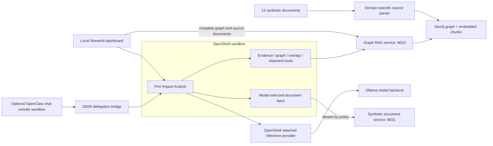

# Asteria Maritime Insights — Port Impact Investigator

An agentic Graph RAG demo that investigates a fictional berth closure: **which scheduled vessel visits overlap it, who operates those vessels, and which shipments are connected?**

The UI includes a document reader, a complete interactive Neo4j relationship map, time-aware evidence, an investigation tool log, and an optional real OpenShell network-denial demonstration. All maritime names, identifiers, schedules and cargo records are synthetic. No bookings, diversions or notifications are executed.

## Architecture and scope



The application adapts a Graph RAG starter kit originally generated on Red Hat OpenShift AI 3.6. **You do not need an OpenShift cluster, cloud account, S3 bucket or API subscription to run this repository.** Dependencies and model weights are downloaded separately.

- The live model chooses tools. Code applies schedule corrections, computes interval overlaps and assembles the factual brief from validated results.
- The graph is **source-parsed**, using this register's structure and stable IDs, not generic LLM extraction. The expected build has 12 chunks, 31 entities and 35 relationships.
- The live investigator runs inside OpenShell; the dashboard and data explorer stay local. The optional model-selected challenge tests destination-level network denial, not document-path authorization.
- Fixture rehearsal is clearly labelled and never silently replaces the live backend.

## Prerequisites

Recommended: macOS or Linux, Python **3.12**, [uv](https://docs.astral.sh/uv/), [Ollama](https://ollama.com/), and [Podman](https://podman.io/) or Docker for Neo4j. A practical starting point is 16 GB RAM (24 GB recommended) and 15 GB free disk; model speed depends on your hardware. Internet is required for initial package, image and model downloads.

For sandbox execution, use OpenShell 0.1.9 with a running gateway and Podman; see [setup](docs/openshell-agent.md). Model access is supplied by an attached provider profile. Local development and fixture rehearsal do not require OpenShell.

Required free local ports: **8501** UI, **8010** Graph RAG, **11434** Ollama, **17474/17687** Neo4j. Port **8031** is a deliberately non-allowlisted destination; no server or document needs to exist there.

## Quick rehearsal — no database or model required

```bash
git clone https://github.com/suhasvkashyap/maritime-graph-rag-demo.git
cd maritime-graph-rag-demo
uv sync --python 3.12 --all-extras --locked
AMI_DATA_MODE=fixture AMI_AGENT_MODE=scripted .venv/bin/streamlit run app.py --server.port 8502
```

Open http://localhost:8502. This verifies the UI and deterministic scenario using checked-in fixtures. Live graph browsing and OpenShell need the corresponding services below.

## Full live setup

Run commands from the repository root unless explicitly changing directories.

### 1. Install both locked Python environments

```bash
uv sync --python 3.12 --all-extras --locked
uv sync --project pattern1 --python 3.12 --extra dev --locked
```

There are two environments: `.venv` for the UI and `pattern1/.venv` for the generated Graph RAG service. Both lockfiles are included. `ai4rag`, Neo4j driver and PDF reader are explicit backend dependencies.

### 2. Configure and start Neo4j

Start your container engine first. For Podman on macOS, initialize/start a Podman machine if you do not already have one.

```bash
.venv/bin/python scripts/setup_local.py --start-neo4j --engine podman
# Docker alternative: --engine docker
```

This generates local `.env` files with a random database password and starts the dedicated `ami-maritime-neo4j` container using Neo4j **2026.10.2**, with persistent volume `ami-maritime-neo4j-data`. It binds database ports only to localhost. No authentication is disabled. Wait for database startup; inspect `podman logs ami-maritime-neo4j` if needed.

Existing `.env` files are preserved. To use your own Neo4j instead, run `scripts/setup_local.py` without `--start-neo4j`, then edit `pattern1/.env`. Do not commit that file. Templates document required variables. The supported source-parser build does not need APOC.

### 3. Download and prepare models

Start Ollama (`ollama serve` in a separate terminal, or its desktop app), then:

```bash
ollama pull qwen2.5:7b
ollama pull bge-m3
ollama create ami-demo3-qwen -f pattern1/scripts/Modelfile.ami-demo3
```

The `ollama` API-key value in the examples is a local compatibility placeholder, not a secret. Model weights are not stored in Git.

### 4. Ingest the synthetic corpus

```bash
(cd pattern1 && .venv/bin/python scripts/build_source_graph.py)
```

Expected counts: **12 chunks / 31 nodes / 35 edges**. The builder reads the included PDF and embeds sections with bge-m3. It is safe to repeat for the same corpus. If changing document content, use a new collection and update the explicit collection guard to avoid stale graph data.

Do not run the experimental `index_corpus.py` model-extraction path for the supported demo.

### 5. Provision the sandbox and inference provider

With the OpenShell 0.1.9 gateway and Podman running:

```bash
./scripts/setup_maritime_sandbox.sh
```

This builds the full investigator image, creates `ami-maritime-agent`, and
attaches the `ami-maritime-inference` provider. The checked-in host addresses
are for Podman on macOS; see [platform assumptions and setup](docs/openshell-agent.md).
An existing sandbox is preserved and setup stops rather than silently reusing
stale code. Follow that guide when rebuilding. No `inference.local` route is
required on OpenShell 0.1.9.

### 6. Launch and verify

```bash
AMI_EXECUTION_MODE=openshell .venv/bin/python scripts/start_demo.py
AMI_EXECUTION_MODE=openshell .venv/bin/python scripts/verify_live.py --agent
```

Open **http://127.0.0.1:8501**. Choose the first question and click **Run investigation**. Expect roughly one to two minutes on a suitable laptop; this is not a latency guarantee. Avoid concurrent investigations.

The launcher preserves background processes and writes logs/PIDs under `.run/`. Use `scripts/start_demo.py --restart` after configuration changes. It does not start Ollama, Neo4j or OpenShell for you.

## Explore the complete graph

Select the **Full Graph RAG** tab beside **Run investigation**, or **View full Graph RAG** in the Data card. The interactive map shows every entity and relationship in the live collection together (currently 31 nodes and 35 edges), including isolated entities and separate source-backed parallel edges.

Use **Fit all**, zoom and pan; search highlights matches without removing other nodes. Select a node to highlight its connections, or an arrow to inspect its source document excerpt. The expandable relationship table and JSON download include the full graph. This overview is not filtered by an investigation cutoff; corrections and proposals remain visible. It displays the entity relationship graph, with retrieval chunks attached as provenance rather than extra nodes.

The read-only `/v1/graph/overview` endpoint is collection-scoped. It refuses oversized collections instead of silently sampling or truncating them. The existing bounded investigation graph remains unchanged.

## Presenter walkthrough and expected results

1. Ask: **Which Halcyon subsidiary-operated calls overlap notice SYN-N017, and which shipments are connected?**
2. At the default cutoff (17 November 2026, 12:00 UTC), C101 alone overlaps the berth closure for **8 hours**. Its operator is Meridian Shelf Shipping; its shipment is S101.
3. Show C103's correction and exclusions for other berths, ports and dates.
4. Select the earlier cutoff (16 November, 12:00 UTC). C103 now also overlaps for **5 hours**, because the later correction was not yet available.
5. Browse the documents and graph relationships, then show the evidence and executed-tool log.

A port call is a scheduled vessel visit, not a phone call. Overlap means planned berth occupancy, not proven delay. The cargo handling proposal remains pending; delivery and diversion are not established.

See [presenter instructions](docs/demo-03.md). Questions beyond this bounded synthetic exercise need further evaluation.

## OpenShell: full agent and model-selected denial

Live investigations now default to executing the complete agent in **ami-maritime-agent**. The dashboard stays local. Model access uses the attached **ami-maritime-inference** provider; the base sandbox policy contains only graph-service access.

**Compatibility:** OpenShell 0.1.9 replaced `inference.local` with provider profiles and sandbox attachments. This demo uses that supported mechanism. Set `AMI_EXECUTION_MODE=local` for explicit unisolated development. Scripted fixture rehearsal remains local by default.

Follow [setup and presenter instructions](docs/openshell-agent.md). The denial challenge lets the model select a synthetic supplemental document request and continue from the resulting error. Verification requires allowed graph retrieval, a model-selected permission error and fresh matching OpenShell audit evidence. No attempt is **not verified**.

The previous probe sandbox and recordings are historical; the new deployment uses a separate name.

## Synthetic data and reproducibility

Everything needed for this maritime scenario is included:

- `assets/graph/documents/D01.md`–`D12.md`: readable individual documents.
- `assets/graph/documents/catalog.json`: UI document catalog.
- `assets/graph/ami_maritime_graph_corpus.pdf`: ingestion artifact.
- `fixtures/corpus_sections.py`: synthetic source generator inputs; `scripts/prepare_assets.py` regenerates the PDF.
- `fixtures/`: canned service responses, evidence and graph expectations for offline tests.
- `pattern1/`: service source, configuration, lockfile, ingestion scripts and tests.
- `deployment/`: maritime policy and full-agent image definition.

After editing/regenerating source data, regenerate the catalog/Markdown with `scripts/export_documents.py`, rebuild into a fresh collection and rerun acceptance checks. Do not substitute data while retaining old expected results.

## Tests

```bash
.venv/bin/python -m pytest tests -q
(cd pattern1 && .venv/bin/python -m unittest discover -s tests -q)
.venv/bin/python scripts/verify_live.py --agent
```

The first two suites do not require live models or a database. Live verification writes ignored JSON/Markdown artifacts under `docs/verified-runs/`.

## Troubleshooting

- **Database authentication/connection:** check `pattern1/.env`, container logs and ports. A pre-existing volume retains its original password.
- **No graph evidence:** run the source graph builder and check `/v1/graph/status` on port 8010.
- **Model unavailable:** check `ollama list`; both `ami-demo3-qwen` and `bge-m3` must exist.
- **Slow/partial investigation:** inspect `.run/backend.log` and `.run/ui.log`; reduce other local workloads. Partial results remain visibly partial.
- **Sandbox test unavailable:** verify `openshell sandbox get ami-maritime-agent` and gateway readiness. No simulated denial is substituted.
- **Ports occupied:** stop conflicting processes or update the relevant config and launcher consistently. Never point this demo at another demo's sandbox.

## Secrets and sharing

`.env`, credentials, virtual environments, logs, caches, runtime outputs and local screenshots are ignored. Setup generates a new database password on each fresh clone, not a shared checked-in password. Run `gitleaks git --redact` before publishing changes. Example configs contain placeholders only. Do not add real customer records or cluster credentials.

This repository is a demonstration, not an official supported Red Hat or NVIDIA product distribution. Dependencies and models retain their respective licenses. No license for upstream code is overridden by this repository.

## Optional OpenClaw conversation interface

OpenClaw adds a conversational assistant that delegates investigations to the
same sandboxed specialist. OpenClaw and its JSON bridge run outside OpenShell;
the specialist, its tools and evidence assembly run inside. The Streamlit
security challenge remains the place to demonstrate model-selected denial.

See [OpenClaw architecture, installation and presenter guide](docs/openclaw.md)
for native and containerized gateway setup, restart commands and troubleshooting.
The gateway uses loopback port 18790; runtime state stays outside the repository.

## What is committed

Source, tests, example configuration, synthetic corpus assets and documentation
are versioned. Demo recordings (`.mov`, `.mp4`, `.webm`, and related formats),
voiceovers, `video-edit/`, generated run records, local diagnostics, credentials
and runtime state are ignored. Keep recordings locally or distribute them
separately; they are not required to run the demo.
