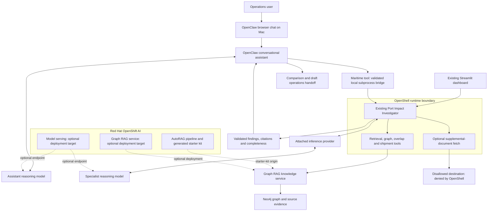

# OpenClaw: conversational delegation to the investigator

OpenClaw adds an ongoing operations conversation to the existing demo. It calls
`investigate_port_impact(question, as_of)` to delegate to the **existing full
investigator inside OpenShell**. The specialist retains its bounded tool loop,
validated evidence, deterministic overlap calculations, corrections, and shipment
tracing. OpenClaw can compare investigations and draft a cited handoff in chat.

### High-level architecture: OpenClaw, OpenShell, and OpenShift AI



**Current local execution:** OpenClaw, the bridge, Streamlit, Graph RAG, Neo4j,
and Ollama run on the Mac or its local container environment. Only the delegated
investigator runs inside OpenShell. The starter kit originated on OpenShift AI
3.6; this extension does not deploy anything to a cluster. Dashed connections
show provenance or future deployment options, not verified live cluster traffic.
Graph RAG is a knowledge tool, not OpenClaw's model provider.

The bridge uses fixed executable arguments and JSON over stdin; there is no new
HTTP bridge, arbitrary-command tool, cluster credential, or fixture fallback.
The dedicated OpenClaw configuration allows only `investigate_port_impact`.
OpenClaw itself is **outside** the OpenShell boundary. Moving it inside is a
separate integration, with its own Node runtime and policy requirements.

### Runtime choices

The optional OpenClaw gateway runs outside the investigator sandbox. Use the
Linux container path on Apple Silicon macOS when native gateway workers cannot
start. Native startup is also provided below. Host-specific diagnostic logs are
local artifacts and are not distributed with the repository.

Before using the container path on a fresh checkout, run
`./scripts/install_openclaw.sh` to create the dedicated host configuration and
workspace; then run `build`, `prepare`, and `start` below. The container image's
OpenShell download and checksum currently target Linux ARM64. Other architectures
require a matching release artifact and checksum in the Containerfile.

### Containerized Gateway on macOS (interim mitigation)

Because the AppleSystemPolicy denial covers every process executed from the
OpenClaw package tree, the Gateway, its SQLite workers and the maritime bridge
run in a Linux container on this Mac. The container preserves the demo security boundary:
the bridge keeps its stdin/stdout JSON contract and the OpenShell CLI's
end-to-end mTLS transport, and the container is published on host loopback only
(127.0.0.1:18790). See `deployment/openclaw-gateway/`.

```bash
podman machine start                    # plus Ollama, Neo4j, OpenShell, Graph RAG (see restart section below)
./scripts/openclaw_container.sh build   # pinned OpenClaw, checksum-verified OpenShell CLI, bridge venv
./scripts/openclaw_container.sh prepare # derive container state + OpenShell registration from the host setup
./scripts/openclaw_container.sh start   # serve http://127.0.0.1:18790
./scripts/openclaw_container.sh health
./scripts/openclaw_container.sh dashboard
# Other commands: logs, verify, stop
```

`prepare` copies the gateway token, model settings and the active OpenShell
gateway registration's mTLS credentials into
`~/.local/share/ami-openclaw/container-state/`, re-pointing them at
`host.containers.internal` — the podman host-gateway address that gvproxy
forwards to macOS loopback and that the gateway TLS certificate names. The
bridge's repo code (`adapters/`, `shared/`) and the plugin are bind-mounted
read-only; investigation artifacts still land in `.run/openclaw-investigations/`.

Verified 2026-11-20: gateway health OK, maritime plugin loaded
(`loadFailedCount=0`), `openshell status` inside the container reports
Connected + Authenticated (mTLS), and a real tool invocation executed a full
sandboxed investigation (run id issued, model loop ran). It returned the
by-design live-data failure only because the Graph RAG service was not started;
start the usual demo services for complete investigations (see the restart
section below).

### Restart after a reboot

Start the container engine, Ollama, your configured Neo4j instance and OpenShell
gateway first. Use the same database and gateway registration used during setup;
do not accidentally switch to an empty database. For the repository's dedicated
Neo4j container, use `podman start ami-maritime-neo4j`. If you chose a Homebrew
Neo4j/OpenShell installation instead, start those services with their usual
service-manager commands and retain the matching `pattern1/.env` configuration.

```bash
./scripts/openclaw_container.sh start
AMI_EXECUTION_MODE=openshell .venv/bin/python scripts/start_demo.py --restart
./scripts/openclaw_container.sh health
curl -fsS http://127.0.0.1:8010/v1/graph/status
./scripts/openclaw_container.sh dashboard
```

The graph status should report 31 entities and 35 relationships. Refresh browser
tabs after a restart to discard stale gateway sessions. If the dashboard requests
a token, retrieve it locally with
`podman exec ami-openclaw-gateway openclaw gateway auth-token --show`; do not
publish or share it. Inspect stale state locks using
`./scripts/openclaw_container.sh recover-lock` and follow its recovery instructions
only after confirming no other gateway is using the state.

### Install and start on a Mac

First complete the [live setup](../README.md#full-live-setup) and [OpenShell setup](openshell-agent.md). Confirm the
Graph RAG service, Ollama, and `ami-maritime-agent` are available. Python `.venv` must be installed; the official Node distribution supplies npm. Then, from the repository root:

```bash
./scripts/install_openclaw.sh
.venv/bin/python scripts/start_openclaw.py
./scripts/openclaw.sh health
./scripts/openclaw.sh dashboard
```

The installer pins **OpenClaw 2026.11.6** and checksum/signature-verified official **Node 24.22.1** under `~/.local/share/ami-openclaw/`.
It does not replace system Node, modify shell startup files, or use `~/.openclaw`.
The local config/state is `~/.local/share/ami-openclaw/state/`; the Gateway binds to loopback
port **18790**, separate from the existing Streamlit UI at **8501**.
The dashboard command opens an authenticated browser URL: do not share its token.
No messaging channels or external model accounts are configured. Set `AMI_OPENCLAW_HOME` to override the dedicated installation directory. Keep it outside a workspace that hard-links files: OpenClaw rejects hard-linked credential databases.

The assistant uses the existing local `ami-demo3-qwen:latest` Ollama model via
Ollama's native API. The specialist continues to use its existing attached
OpenShell inference provider. There are two model loops, so end-to-end latency
is higher than calling the specialist alone. Run one investigation at a time;
avoid running the Streamlit investigator or denial challenge concurrently.

Configuration creation preserves an existing config. Source instructions in
`openclaw/workspace/` are copied to the dedicated runtime workspace on first setup.
After changing those instructions, copy the changed files into
`~/.local/share/ami-openclaw/state/workspace/` and start a new conversation. Plugin source is
loaded from `openclaw/maritime-plugin/`; restart the Gateway after plugin edits.

### Presenter sequence

In OpenClaw's browser chat:

1. **“Investigate which Halcyon subsidiary-operated calls overlap SYN-N017 and
   which shipments are connected, as of 2026-11-17T12:00:00Z. Cite sources.”**
   Expected specialist result: C101 overlaps for eight hours; S101 is connected.
2. **“Now investigate the same question as of 2026-11-16T12:00:00Z and compare
   with the previous result. Explain why C103 changes.”**
   The earlier assessment additionally includes C103 with five hours of overlap.
   The later D09 correction explains its exclusion in the current assessment.
3. **“Draft a concise operations handoff using those results. Include the
   cutoff, citations, unresolved questions, and pending proposals.”**
   This creates a draft in chat; no operational action or notification executes.

“Yesterday” means the earlier exercise cutoff, not the computer's current date.
The tool returns explicit complete/partial/needs_input/failed status. OpenClaw is
instructed to preserve it and cite source/evidence IDs; its generated prose must
still be checked against the returned specialist evidence. Planned berth overlap
is not proven delay. A pending proposal is not an approved diversion or delivery.

The existing **Streamlit denial challenge remains separate**. This delegation
tool does not verify enforcement. Show the original challenge and matching fresh
OpenShell audit event when presenting the runtime-security story.

### Verify and troubleshoot

```bash
./scripts/openclaw.sh plugins list
./scripts/openclaw.sh security audit
.venv/bin/python -m pytest tests -q
# CLI conversation through the same Gateway (same session ID for follow-ups):
./scripts/openclaw.sh agent --session-id maritime-demo --message \
  'Investigate SYN-N017 as of 2026-11-17T12:00:00Z and cite the evidence.' --json
# Stop only the managed demo Gateway:
.venv/bin/python scripts/start_openclaw.py --stop
```

A direct live check of the JavaScript tool (independent of Gateway startup):

```bash
~/.local/share/ami-openclaw/official-node/bin/node \
  scripts/verify_openclaw_tool.mjs 2026-11-16T12:00:00Z
```

This executes the real plugin tool and sandboxed specialist. It does not prove
that an OpenClaw model selected the tool. The check writes
`.run/openclaw-tool-validation.json` and exits nonzero unless the result is complete.

Gateway logs: `.run/openclaw-gateway.log`. Full delegated run artifacts:
`.run/openclaw-investigations/*.json` (request, validated result, and evidence).
Run artifacts are ignored repository state; chat history and credentials live in the dedicated home-directory state, not committed demo assets.
A failed sandbox/provider check is an error; the tool never silently switches to
local execution or fixtures. A `busy` response means another bridge invocation
is still active. If port 18790 belongs to another process, resolve that conflict
before starting this Gateway.

Implementation: `adapters/openclaw_bridge.py`, `openclaw/maritime-plugin/`, and
`openclaw/workspace/`. Setup and lifecycle scripts are under `scripts/`.
Official references: [OpenClaw plugins](https://docs.openclaw.ai/plugins/building-plugins),
[Ollama provider](https://docs.openclaw.ai/providers/ollama), and
[OpenShell](https://docs.nvidia.com/openshell/latest/about/overview).
